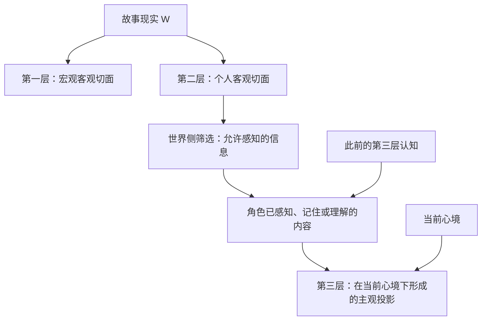
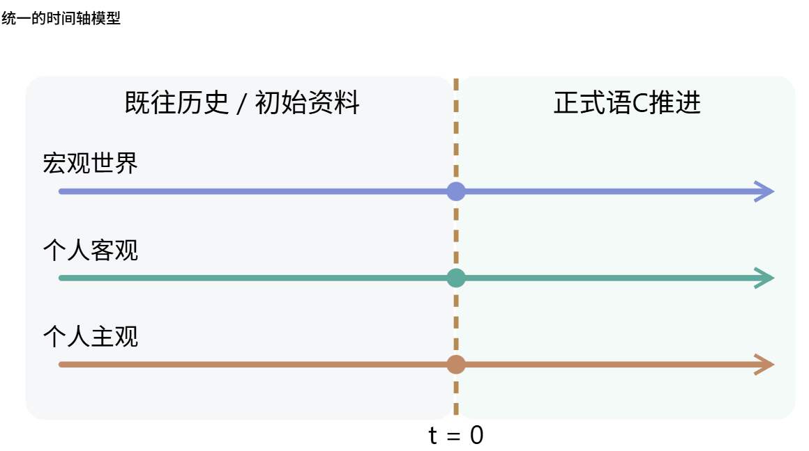
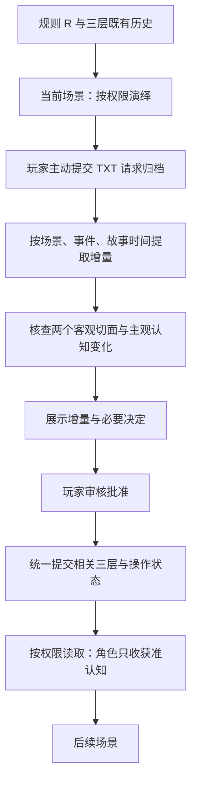

# Storyline Memory

**两个客观切面，一个由既有认知在当前心境下形成的主观投影。**

由玩家主动归档、审核后提交的长期语C记忆工作流。世界书和角色卡的内容进入同一条时间轴的前史，后续剧情沿相同结构延续。

Concept and design direction: **NakanoIchirou**. Prepared with Codex assistance, 2026-10-13.

## 三层之间是什么关系？

宏观历史与个人客观经历是故事现实中不同尺度的切面。个人主观则是：**此前主观所认知到的个人客观经历，在现在心境下形成的投影。**



箭头表示概念关系与信息边界，不是额外文件、叙事层或新增心理引擎。现实 W 是故事整体的比喻，不要求另建全知事件库。“切面”和“投影”也不是需要计算的几何运算。

| 层 | 保存什么 | 不意味着什么 |
| --- | --- | --- |
| 第一层：宏观客观历史 | 制度、社会、环境等世界变化及必要初始事实 | 不保存每个人的全部生活 |
| 第二层：个人客观经历 | 已确立的行动、互动、遭遇与关系事实 | 不因本人遗忘而删除，也不直接给角色读取 |
| 第三层：个人主观认知 | 已认知经历的记忆、信念、误解与当前理解，以及心理状态的历史 | 不从未知客观档案直接生成认知，不自动获得真相 |

第一层不是第二层的完整来源，私人事件可以只进入个人档案。三层都是有损摘要，未记载不等于未发生。

第三层有自身的连续历史。后来重新理解一件事，应追加或明确替代当前认知，保留“当时怎么想”的记录，不能改成“她一直这样想”。曾知但已遗忘的内容也不自动重新可用。

例如，Saki 只知道 Ren 没有赴约。她过去认为“他不在乎我”，现在心境缓和，改想“他也许遇到了困难”。**这是已知经历的重新解释，不是新事实。** Ren 当时住院的客观真相不能随心境变化自动进入她的认知；听到 Ren 的说法后，也应先记录“Ren 告诉我……”，不立即升级为核实事实。

## 世界书和角色卡归到哪里？

T=0 是玩家开始参与的锚点。以下选用用户提供的第四张图说明连续时间轴；它不包含前三层关系的旧画法：



| 初始素材 | T＜0 与开场状态的落位 | T≥0 如何延续 |
| --- | --- | --- |
| 世界书的历史、地理、制度和环境事实 | 第一层 | 追加获批的宏观变化 |
| 角色卡的身份、履历和客观关系 | 该角色第二层 | 追加实际经历 |
| 角色卡的记忆、信念、已知信息和心理状态 | 该角色第三层 | 新感知与对既有认知的重新理解 |
| 玩家控制权、生成约束和叙事风格 | Rules.md | 配置演绎与归档行为 |

T＜0 与 T≥0 使用相同记录结构。初始地理与心理状态可直接填写，不要求编造形成事件或童年创伤。旧世界书和角色卡可保留溯源，不再成为另一套并行权威。

## 玩家目录与仓库目录

每个故事独立保存：

```text
My-Story/
├── Rules.md                  # 作者规则，不是第一层
├── World-Storyline.md        # 第一层：宏观客观切面
└── Character/
    └── Saki/
        ├── Objective.md      # 第二层：个人客观切面
        └── Subjective.md     # 第三层：个人主观投影的历史
```

根目录的三个项目是文件布局，不对应三层编号。角色名单由玩家指定，不自动加入示例人物。生成模板：

```powershell
python scripts/init_workspace.py --root D:\CodexProject\My-Story --characters Saki
```

命令不覆盖已有文件，不填定设定，也不自动提交历史。Subjective.md 含历史认知及来源，角色仍须通过筛选后的认知包接收信息，不能直接读取整份文件或整个目录。

本仓库按用途组织：

| 位置 | 用途 |
| --- | --- |
| [SKILL.md](SKILL.md) | 给 LLM 的初始化、提取、审核和隔离指令 |
| [references](references/local-workflow.md) | 可选工具格式与设计来源 |
| [assets/workspace](assets/workspace) | 玩家目录模板 |
| [assets/diagrams](assets/diagrams) | 概念说明图，不是剧情档案 |
| [examples](examples/skill-trial.md) | 原始用例、实际归档草案与自测报告 |
| [scripts](scripts) | 标准库机械辅助与测试 |

## 分清规则、配置与硬编码

Rules.md 是可编辑的作者规则配置；**写死在程序代码里的行为才叫硬编码。**

三层职责、权限、审核与整体回滚是机制。叙事语气、按场景分段和作者指定的不可变约束是运行规则。具体地名、时代、席位、人物关系和心理状态则是 Storyline 内容。

“目前有一百席议会”是世界事实；“作者规定席位永远不得改变”才是明确约束。不能自行把确定的初始设定变成永久规则，也不加入未经确认的权重、遗忘公式或数值人格参数。规则不成为第四条 Storyline。

## 从演绎到下一次使用




当前上下文是演绎现场，不是第四条持久 Storyline。流程循环不代表每轮归档。跨 TXT 保持事件标识，文件结束不代表事件完结。

归档检查点按故事时间补全受追踪角色的幕后候选，获批才提交；没有变化可以只更新覆盖时间。角色不逐轮后台运行。无冲突内容集中审核，事实自行查证，真正需要玩家选择的动机、补录和重大变化才提出问题。

## 用例与测试

[Skill 实际自测](examples/skill-trial.md)记录了本次按 Skill 阅读两份 TXT 后给出的三层草案、审核事项与角色包。用例验证 Saki 在新心境下重新理解旧失约，同时仍不知道 Ren 住院；跨文件获知 Ren 的说法后，保留“听到的说法”与“客观真相”的区别。

运行标准库测试：

```powershell
$env:TEMP = 'D:\CodexProject\Storyline-Memory\.tmp'
$env:TMP = $env:TEMP
$env:TMPDIR = $env:TEMP
$env:PYTHONDONTWRITEBYTECODE = '1'
New-Item -ItemType Directory -Force $env:TEMP | Out-Null
python -m unittest discover -s scripts -p 'test_*.py' -v
```

语义自测是本次作者助手执行 Skill 后的自查，非独立盲测。脚本使用人工整理的用例记录验证持久化、版本、续接和输出过滤，不具备 TXT 语义理解能力。测试不证明长篇摘要质量、实际 Token 优势或宿主硬权限隔离。

## 当前原型边界

Markdown 工作流以审核后的正文为正式记录，版本操作覆盖全部相关文件。可选 JSON 工具以获批快照为正式状态，Markdown 仅作标明版本的展示或待导入草稿。**当前没有 Markdown 与 JSON 自动同步，不能维护两套独立权威。**

工具不调用模型，不运行角色 Agent；批准散列防误提交，不是身份认证。角色包过滤不替代宿主文件、工具和会话隔离。Windows 工具保留本工程将数据放在 D 盘的约定，这不是三层模型的必要条件。

[来源与取舍](references/sources.md)说明对 Smart Memory 等实现的选择性借鉴，没有复制上游代码或承诺首创。

English: Two objective slices of story reality, plus a subjective projection of previously recognized personal experience through the character's present state of mind. New knowledge requires authorized perception; a change of interpretation does not reveal hidden objective facts.
